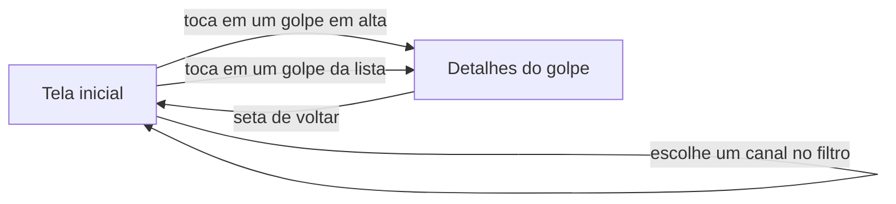
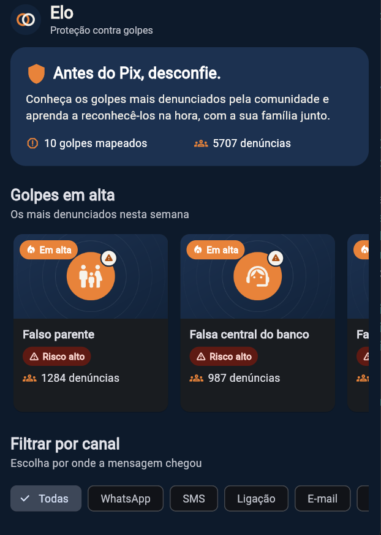
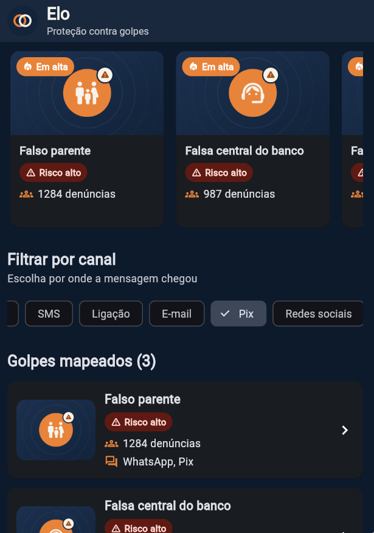
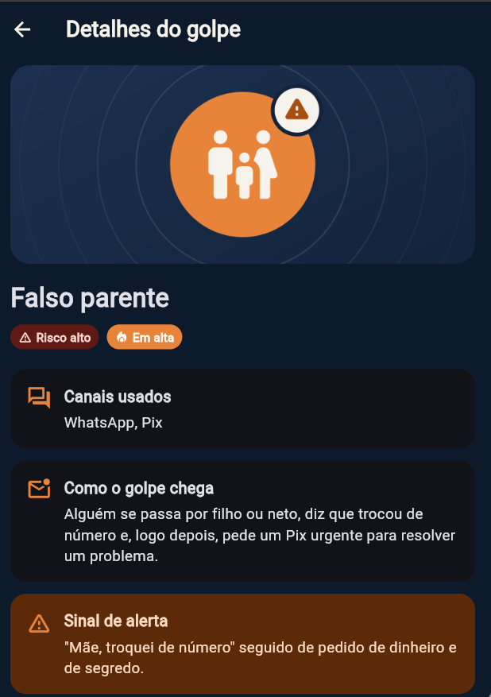
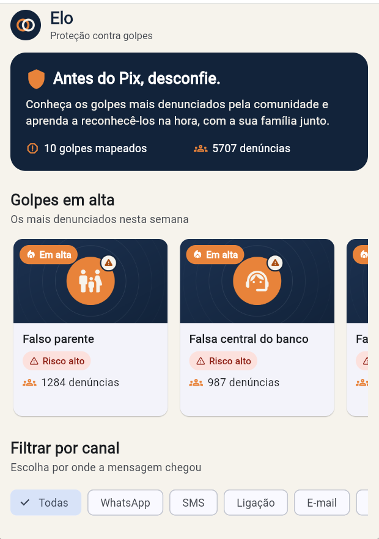

# Elo - Proteção contra golpes para idosos

Global Solution 2026.2 · FIAP · Sistemas de Informação · Squad Carbono

## Descrição da solução

Quase todo mundo conhece algum idoso que já recebeu mensagem de "filho com número novo" pedindo Pix, ou ligação de uma suposta central do banco. O Elo nasceu dessa preocupação, com uma ideia simples: proteger essas pessoas **antes do Pix** e **com a família junto**.

Nesta entrega em Flutter, construímos a **central de golpes do Elo**, um app que reúne os golpes mais denunciados pela comunidade e explica, em linguagem simples, como cada um funciona. Na tela inicial a pessoa encontra:

- um resumo com o total de golpes mapeados e de denúncias;
- os **golpes em alta**, numa lista horizontal com os casos mais denunciados da semana;
- um **filtro por canal** (WhatsApp, SMS, Ligação, E-mail, Pix e Redes sociais), que mostra só os golpes que chegam por aquele meio;
- a lista com **todos os golpes mapeados**, cada um com imagem, nível de risco, número de denúncias e canais.

Ao tocar em um golpe, abre uma tela com como ele chega, o sinal de alerta e o que fazer na hora. Como o público principal é de pessoas mais velhas, usamos letras maiores, cores com bom contraste e telas sem excesso de informação. O app também acompanha o tema claro ou escuro do celular.

## Tema da Global Solution

O tema da GS é **CitizenTech: tecnologia a serviço do cidadão**. Escolhemos os golpes financeiros contra idosos porque os números assustam:

- Em 2025, o Brasil registrou 2,26 milhões de estelionatos, 430% a mais que em 2018 (Fórum Brasileiro de Segurança Pública, 20º Anuário).
- Pessoas com 60 anos ou mais perdem, em média, 5 vezes mais dinheiro em golpes com Pix (Silverguard, com dados do Banco Central).
- Só 7,9% do valor perdido volta integralmente pelo MED, o mecanismo de devolução do Pix.

Depois que o dinheiro sai, quase nada volta. Por isso o foco do Elo é ensinar a reconhecer o golpe antes. O projeto conversa com os ODS 10.2 (inclusão de todas as pessoas, independentemente da idade), 4 (educação) e 16.4 (combate aos fluxos financeiros ilícitos).

## Fluxo de telas

O app tem duas telas: a tela inicial e a de detalhes do golpe.



1. O app abre na **tela inicial**. De cima para baixo ela mostra o resumo, os golpes em alta, o filtro por canal e a lista de golpes mapeados, tudo rolando junto como uma página só.
2. Ao escolher um canal no filtro, a pessoa continua na mesma tela, mas a lista passa a mostrar só os golpes daquele canal. O título da seção mostra quantos aparecem, por exemplo "Golpes mapeados (3)".
3. Ao tocar em qualquer golpe, da lista ou dos destaques, ela vai para a **tela de detalhes**.
4. Pela seta no topo ou pelo botão voltar do celular, ela volta para a tela inicial, com o filtro que tinha escolhido.

## Prints das telas

| Tela inicial (tema escuro) | Filtro "Pix" aplicado | Detalhes do golpe | Tela inicial (tema claro) |
|---|---|---|---|
|  |  |  |  |

## API utilizada

O app **não consome API externa**. Os dados ficam em memória, na classe `GolpeRepository`, que funciona como a base comunitária de golpes do Elo. Por isso o app funciona offline e não usa nenhum pacote além do próprio Flutter.

Sobre o conteúdo:

- Os 10 golpes são modalidades reais e comuns no Brasil: falso parente, falsa central do banco, falso INSS, loja falsa, clonagem do WhatsApp, mão fantasma, entrega pendente, empréstimo falso, boleto falso e falso prêmio. Os textos foram escritos pelo grupo a partir desses casos.
- Os números de denúncias são fictícios, criados para a demonstração.
- As imagens foram montadas pelo grupo com ícones do Material Design Icons, do Google (licença Apache 2.0), e ficam em `assets/images`.

## Arquitetura

Organizamos o projeto separando modelos, repositório, telas, widgets e tema, cada um na sua pasta:

```
lib/
├── main.dart                     - inicia o app e aplica os temas claro e escuro
├── models/
│   ├── golpe.dart                - classe Golpe
│   ├── categoria.dart            - enum dos canais (categorias)
│   └── nivel_risco.dart          - enum dos níveis de risco
├── repositories/
│   └── golpe_repository.dart     - lista de golpes e métodos de consulta
├── screens/
│   ├── home_screen.dart          - tela inicial
│   └── golpe_detail_screen.dart  - tela de detalhes
├── widgets/
│   ├── golpe_card.dart           - item da lista principal
│   ├── categoria_selector.dart   - lista horizontal de categorias
│   ├── destaques_section.dart    - lista horizontal de destaques
│   ├── destaque_card.dart        - item dos destaques
│   ├── nivel_risco_badge.dart    - selo do nível de risco
│   ├── selo_em_alta.dart         - selo "Em alta"
│   ├── info_linha.dart           - ícone com uma informação curta
│   ├── info_bloco.dart           - blocos de texto da tela de detalhes
│   ├── resumo_card.dart          - resumo do topo da tela inicial
│   ├── secao_titulo.dart         - título das seções
│   └── elo_logo.dart             - logotipo
└── theme/
    ├── app_colors.dart           - cores do Elo
    └── app_theme.dart            - temas claro e escuro
```

**Como cada parte funciona**

- **Modelos:** a classe `Golpe` tem atributos tipados e construtor com parâmetros nomeados. Como um golpe pode chegar por mais de um canal, ele guarda uma `List<Categoria>`. O booleano `emDestaque` marca os golpes em alta. As categorias e os níveis de risco são `enum`, cada um com um `label` para aparecer na tela.
- **Repositório:** o `GolpeRepository` é o único lugar onde os golpes são criados. Ele oferece `getGolpes()`, `getDestaques()` (filtra pelo `emDestaque`), `filtrarPorCategoria()` e `totalDenuncias()`. As telas só pedem os dados.
- **Widgets:** cada componente fica no seu arquivo e só mostra o que recebe por parâmetro. Quando o usuário toca em algo, o widget avisa a tela por callback (`VoidCallback` ou `ValueChanged`). Os principais são o `GolpeCard` (lista vertical), o `CategoriaSelector` (categorias) e o `DestaquesSection` com o `DestaqueCard` (destaques). O `NivelRiscoBadge` e o `InfoLinha` são reutilizados em várias partes.
- **Telas:** a `HomeScreen` é um `StatefulWidget` e guarda a categoria escolhida em `Categoria? _categoriaSelecionada`. O valor `null` representa "Todas", que não é um canal e por isso não entra no enum. A `GolpeDetailScreen` é um `StatelessWidget`, porque só exibe o golpe que recebe.

**O que acontece quando o usuário filtra**

1. O usuário toca em "Pix" e o `CategoriaSelector` chama `onCategoriaSelecionada(Categoria.pix)`.
2. A `HomeScreen` faz o `setState` e guarda a categoria escolhida.
3. A tela é reconstruída e o getter `_golpesFiltrados`, que fica fora do `build`, pede ao repositório `filtrarPorCategoria(Categoria.pix)`.
4. O repositório devolve só os golpes cuja lista de categorias contém `Categoria.pix`.
5. A `ListView.builder` mostra a nova lista e o título passa para "Golpes mapeados (3)".

## Desenvolvedores

| Nome completo | RM |
|---|---|
| Fernando Henrique Mendes da Silva | RM559838 |
| Pedro Chamusca de Mello | RM559632 |
| Cassia Emanuelly Dantas da Silva | RM561073 |
